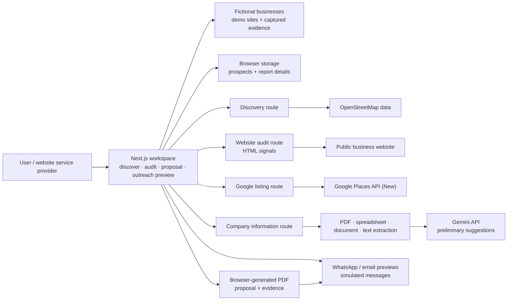

# LocalPulse

<p align="center">
  
</p>

<p align="center">
  
  
  
  
</p>

**LocalPulse** helps find local businesses, review their online presence, and prepare an evidence-backed website proposal for an owner.

- **Deployed Project:** [localpulse-my.vercel.app](https://localpulse-my.vercel.app/)
- **Sample company information:** [Download the fictional Bluebird PDF](public/samples/bluebird-company-information.pdf)

> This is a working prototype, not a complete business audit. Demo businesses and outreach conversations are fictional. Live website checks inspect returned HTML rather than a rendered mobile experience; Google review responses cannot currently be verified. Check findings and prices before sharing a proposal.

## Table of Contents

- [Project Overview](#project-overview)
- [Installation & Setup](#installation--setup)
- [Project Structure](#project-structure)
- [System Architecture](#system-architecture)
- [Tech Stack](#tech-stack)
- [Core Features](#core-features)

## Project Overview

Local businesses can be difficult to discover online, and reviewing each website and listing by hand takes time. LocalPulse brings those checks into a guided flow for someone offering website services:

1. **Discover:** search for businesses around Kuala Lumpur or another supported area, select a radar result, or provide company information.
2. **Audit:** review website and contact signals, Google listing candidates, prioritised opportunities and any available visual evidence.
3. **Prepare:** customise your business details and an indicative price, then download a branded English, Bahasa Malaysia or Simplified Chinese PDF.
4. **Start a conversation:** preview an introduction and attachment in a WhatsApp-style or email interface; a simulated interested reply unlocks a proposed before-and-after concept.

Demo mode is enabled by default. It provides four fictional businesses and does not use Google services for the sample flow. The radar is illustrative: its pins are not geographically accurate map positions.

## Installation & Setup

### Run the application

```bash
git clone https://github.com/ryanlau1220/LocalPulse.git
cd LocalPulse
pnpm install --frozen-lockfile
pnpm dev
```

Open [http://localhost:3001](http://localhost:3001). The fictional demo is ready to use without entering data. For a production build, run `pnpm build` followed by `pnpm start`; the production server defaults to port 3000.

### Configure optional services

Create a file named `.env.local` in the project root and add only the keys you need:

```dotenv
GOOGLE_PLACES_API_KEY=your_google_places_key
GEMINI_API_KEY=your_gemini_key
```

Restart the development server after changing the file. Enable the relevant Google APIs, restrict the keys to their required services and set appropriate quotas. Keep real keys in `.env.local` or deployment secrets; do not commit them or put them in browser-side code. Google service availability and free allowances depend on the project and its billing configuration; a budget alert is not a spending cap.

## Project Structure

```text
LocalPulse/
├── app/
│   ├── api/                # Discovery, website audit, Google and document routes
│   ├── demo/               # Fictional business websites
│   ├── workspace.js       # Guided discovery, audit, proposal and outreach UI
│   ├── report-preview.js  # On-screen proposal preview
│   └── globals.css        # Layout, branding and motion
├── lib/                    # Audit, evidence, demo data, document and PDF logic
├── public/
│   ├── businesses/        # Fictional business logos
│   ├── evidence/          # Generated inspection views for demo findings
│   ├── fonts/             # Chinese PDF font and licence
│   └── samples/           # Sample company-information PDF
├── scripts/                # Regression, live-check and evidence-capture scripts
├── tests/                  # Unit and Playwright workflow tests
├── docs/                   # README screenshot
├── next.config.js          # Next.js configuration
└── pnpm-lock.yaml          # Pinned JavaScript dependencies
```

Generated files, browser storage and local environment variables are not shared through the repository. The demo websites, screenshots and measurements are committed as fictional examples.

## System Architecture



The browser communicates with same-origin Next.js routes for live discovery, website checks, Google lookups and document analysis. API keys stay on the server. The PDF and outreach previews are created in the browser; no message is sent to a business.

## Tech Stack

| Area | Technology | Purpose |
| --- | --- | --- |
| Interface | Next.js 16, React 19, CSS | Guided workspace, responsive layout and motion |
| Discovery and audit | OpenStreetMap API, Node.js, fast-xml-parser | Find mapped businesses and inspect returned website HTML |
| Google and AI | Google Places API (New), Gemini API | Listing candidates and company-information suggestions |
| Documents | jsPDF, pdf-parse, ExcelJS, Mammoth | Generate proposals and extract text from supported uploads |
| Hosting and data | Vercel, browser local storage | Host the prototype and save prospects on the current browser |
| Quality and automation | Node.js test runner, Playwright, pnpm | Unit tests, browser workflows and repeatable scripts |

## Core Features

- **Guided discovery:** search a selected area, choose a radar pin, open its website and start an audit. Device location is requested only when you select it.
- **Fictional demo:** explore Bluebird Corner Cafe, Luma Hair Studio, Petal & Stem and Golden Crumb Bakery, each with a sample website and business branding.
- **Company information upload:** provide PDF, XLSX, DOCX, CSV or TXT files and notes for preliminary Gemini suggestions. A fictional [sample PDF](public/samples/bluebird-company-information.pdf) is included.
- **Website and listing checks:** identify signals for website availability, mobile viewport, descriptions, headings, HTTPS, direct links and booking paths; select a matching Google listing when configured.
- **Action plan and evidence:** review priority and estimated effort, expand a relevant screenshot, add reviewer-supplied evidence and mark an area for review.
- **Multilingual PDF:** prepare a branded portrait report in English, Bahasa Malaysia or Simplified Chinese with findings, evidence and editable proposal details.
- **Outreach and comparison preview:** preview a message and attached PDF, simulate an interested response, and send a proposed before-and-after concept within the demo conversation.
- **Local shortlist:** save prospects and report details in the current browser and switch between the separate demo and live workspaces.

Built during [PIVOT 2026: Build with AI](https://luma.com/01d8h02p?tk=d9WPGu)
